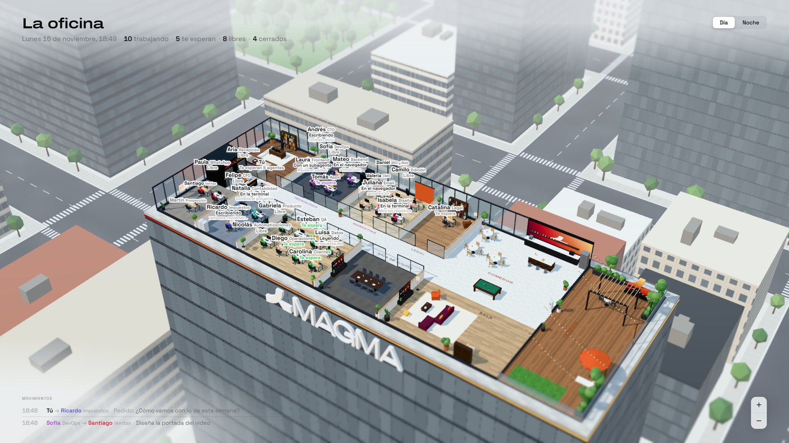
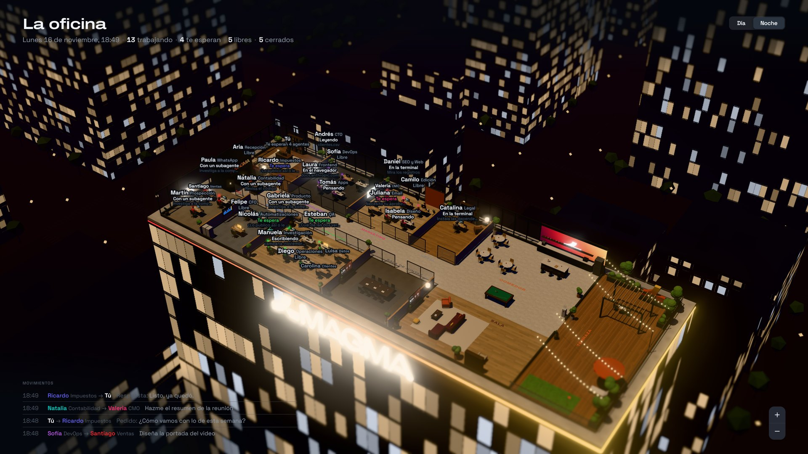

# La oficina virtual

Una oficina en 3D, en el último piso de una torre, donde tus agentes de IA trabajan en vivo. Cada agente es una persona en su puesto: si está trabajando, teclea y su pantalla enseña lo que hace; si te espera, levanta la mano; si está libre, se toma un café. Cuando uno le pasa un encargo a otro, se levanta y se lo lleva caminando.

Ponle tu marca, tus colores y tus agentes, y conéctala a tus sesiones de Claude Code para verlas trabajar de verdad.

**Mírala en vivo: https://magma-cg.github.io/oficina-virtual/**





## Cómo se corre

Solo necesitas [Node.js](https://nodejs.org) 18 o más nuevo. No hay nada que instalar.

```bash
git clone https://github.com/magma-cg/oficina-virtual.git
cd oficina-virtual
node server.mjs
```

Y abre **http://127.0.0.1:5250** en Chrome o Edge.

Arranca en modo demo: los agentes trabajan, esperan, descansan, se mandan encargos y reciben pedidos tuyos, todo simulado, para que la veas viva sin conectar nada.

## Publícala gratis

Como sitio estático, la oficina corre el modo demo sin servidor: sirve cualquier hosting de archivos.

- **GitHub Pages:** haz tu copia del repo (Fork) y en tu copia ve a *Settings → Pages → Source* y escoge *GitHub Actions*. El flujo `.github/workflows/pages.yml` la publica en `https://<tu-usuario>.github.io/oficina-virtual/` cada vez que subas un cambio. Para que salga con tu marca, sube tu `oficina.config.json` (quítalo de `.gitignore`) o cambia el de ejemplo.
- **Cualquier otro:** sube la carpeta `public/` con tu `oficina.config.json` adentro (Vercel, Netlify, Cloudflare Pages, tu servidor).

El modo Claude Code solo funciona con `node server.mjs` en tu computador, porque lee tus sesiones locales: eso nunca sale a internet.

## Ponle tu marca

1. Copia `oficina.config.ejemplo.json` y llámalo `oficina.config.json`. Ese archivo es tuyo y git no lo sube.
2. En `marca`, cambia el nombre, el título y los colores. Los cuatro primeros colores (`vino`, `rojo`, `naranja`, `amarillo`) hacen el degradado que sale en la franja de la torre, el muro del comedor, el logo de los ascensores y la escultura de la terraza: van del más oscuro al más claro.
3. Cambia los dos logos de `public/marca/`: `logo.svg` (el que va en la fachada, la recepción y el televisor) y `isotipo.svg` (el símbolo solo: la escultura, el muro y las pantallas en reposo). Sirve cualquier SVG de un color; la oficina lo pinta.
4. Las letras son Archivo Expanded (títulos) y Space Grotesk (texto), en `public/marca/`. Para usar otras, cambia esos archivos o el `@font-face` de `public/oficina.css`.

## Tus agentes

En `zonas` va cada departamento con sus agentes:

```json
{
  "clave": "marketing", "nombre": "Marketing", "color": "rosado",
  "agentes": [
    { "id": "cmo", "nombre": "Valeria", "cargo": "CMO", "genero": "f" },
    { "id": "redes", "nombre": "Mariana", "cargo": "Redes", "genero": "f" }
  ]
}
```

- `nombre` es como se llama la persona en la oficina y `cargo` sale al lado, más pequeño.
- `color` es el de la camisa y la esfera: `rojo`, `azul`, `turquesa`, `indigo`, `titanio`, `morado`, `rosado`, `verde`, `naranja`, `marca` o un hexadecimal.
- Las salas crecen solas con la cantidad de agentes.
- Algunas claves traen sus muebles: `it` el rack de servidores, `marketing` el rincón donde se graba, `juridico` la biblioteca, `finanzas` los archivadores y la pantalla de números, `comercial` el tablero del embudo. Cualquier otra clave sale con su planta y sus escritorios.
- `dueno` eres tú, en la oficina del fondo, y `recepcion` es quien está frente a los ascensores (pon `"recepcion": false` si no lo quieres).

## Conéctala a Claude Code

Con `"fuente": "claude"`, cada agente que tenga `claude` en la configuración lee la sesión más reciente de Claude Code de esa carpeta y la oficina muestra lo que está haciendo de verdad:

```json
{ "id": "backend", "nombre": "Mateo", "cargo": "Backend", "claude": "~/.claude/projects/C--code-mi-api" }
```

- Las sesiones viven en `~/.claude/projects/`, una carpeta por proyecto.
- Con `"claude": "auto"` el agente toma una de tus sesiones más recientes, de cualquier proyecto (el primero que tenga `auto` toma la más reciente, el segundo la siguiente, y así).
- **Trabajando**: hay un turno abierto y la sesión se movió en los últimos 5 minutos. Se ve si está en la terminal, leyendo, escribiendo, en el navegador, pensando o con un subagente, con la descripción de lo que corre (nunca el comando entero).
- **Te espera**: el turno terminó preguntándote algo, o te pidió aprobar un plan.
- **Libre**: la sesión se movió en la última media hora. **Cerrado**: lleva más tiempo quieta.

Solo lee los archivos: no escribe en ningún lado ni le manda nada a Claude.

## Conéctala a lo que quieras

La página solo le pide al servidor `GET /api/oficina` cada 2,5 segundos. Si tus agentes viven en otro lado (n8n, LangGraph, tu propio backend), cambia esa función de `server.mjs` y devuelve lo mismo:

```json
{
  "zonas": [{ "clave": "marketing", "nombre": "Marketing", "puestos": ["cmo", "redes"] }],
  "puestos": {
    "cmo": { "nombre": "CMO", "alias": "Valeria", "genero": "f", "zona": "marketing", "paleta": ["#FF2D78", "#FF8DBA", "#B0115A", "#FFE3F0"],
             "estado": "trabajando", "actividad": "escribiendo", "frase": "Escribiendo", "detalle": "campana.md", "desde": "2026-11-16 10:30:00", "bandeja": 2 }
  },
  "encargos": [{ "id": 1, "de": "cmo", "para": "redes", "titulo": "Diseña la portada", "estado": "nuevo", "creado": "2026-11-16 10:31:00", "cerrado": null }],
  "pedidos": [{ "id": "p1", "de": "dueno", "para": "cmo", "tipo": "voz", "cuando": "2026-11-16 10:32:00", "texto": "¿Cómo vamos?" }]
}
```

`estado` es `trabajando`, `espera`, `libre` o `cerrado`; `actividad` es `terminal`, `leyendo`, `escribiendo`, `navegador`, `pensando` o `equipo`. Un encargo nuevo hace que su dueño se levante a llevarlo, y cuando pasa a otro estado el otro le lleva la respuesta.

## Cómo se maneja

- Arrastrar gira la maqueta; con el botón derecho (o Shift) se corre; la rueda acerca donde está el cursor.
- Un toque en una sala la enmarca y, ya cerca, un toque en una persona la enmarca a ella. Esc o «Toda la oficina» vuelven.
- `?tema=noche` o `?tema=dia` fijan la luz; `?zona=marketing` la abre en esa sala; `?vitrina` la hace girar despacio, para una pantalla en la pared.

## Rendimiento

Dibuja a 30 cuadros como mucho (60 solo mientras mueves la cámara) y se detiene con la pestaña oculta. Tiene tres niveles de calidad: **alta** (sombras de contacto, brillo de noche y el desenfoque de maqueta), **media** (sin las sombras de contacto) y **baja** (sin efectos). Arranca en alta y baja sola si la tarjeta gráfica no alcanza; `?calidad=alta|media|baja` lo fija y `?dpr=2` fuerza la resolución, por ejemplo para sacar capturas en 4K.

## Seguridad

El servidor solo escucha en `127.0.0.1`, solo responde a `localhost`, solo acepta lecturas y no carga nada de internet. Si la quieres ver desde otro equipo, ponla detrás de algo que pida contraseña.

## Créditos y licencia

Hecha por [Magma Consulting Group](https://magmaconsultinggroup.com) con [Three.js](https://threejs.org).

- El código es libre, con licencia MIT (`LICENSE`): úsalo, cámbialo y ponle tu marca.
- Three.js va en `public/vendor/` con su propia licencia MIT (`public/vendor/LICENSE-three.txt`).
- Archivo y Space Grotesk tienen licencia SIL Open Font (`public/marca/OFL.txt`).
- El nombre y el logo de Magma son marca de Magma Consulting Group y vienen solo de ejemplo: la licencia del código no los incluye. Cámbialos por los tuyos.
